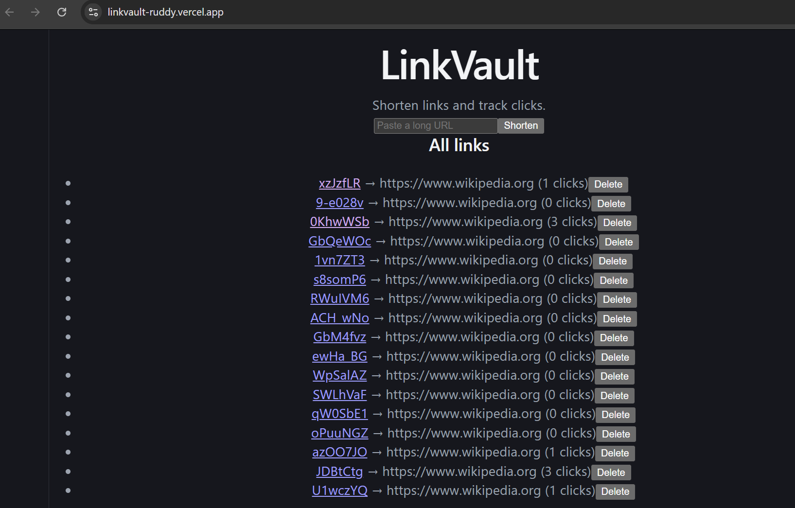

# LinkVault

A URL shortener with click analytics, built with the MERN stack.



## Live Demo

- Frontend: https://linkvault-ruddy.vercel.app
- Backend API: https://linkvault-api-6o1a.onrender.com/api/health

> Note: the backend is on Render's free tier and sleeps after inactivity. The first request can take about 50 seconds to wake it up.

## Tech Stack

- **Frontend:** React (Vite)
- **Backend:** Node.js, Express 5
- **Database:** MongoDB Atlas (Mongoose)
- **Hosting:** Vercel (frontend), Render (backend)

## Features

- Shorten any http/https URL into a 7-character code (nanoid, with collision retry)
- URL validation and rate limiting (20 requests/minute on creation)
- Optional link expiry (`expiresInDays`), auto-deleted by a MongoDB TTL index
- Every redirect records a click (time, browser, referrer)
- Per-link stats endpoint with recent clicks and browser breakdown
- Deleting a link also deletes its click records

## API Endpoints

| Method | Endpoint | Description | Status codes |
|--------|----------|-------------|--------------|
| POST | /api/links | Create a short link (body: `originalUrl`, optional `expiresInDays`) | 201, 400, 429 |
| GET | /api/links | List all links, newest first | 200 |
| GET | /api/links/:shortCode | Get one link | 200, 404 |
| GET | /api/links/:shortCode/stats | Link, recent clicks, browser counts | 200, 404 |
| DELETE | /api/links/:id | Delete a link and its clicks | 200, 404 |
| GET | /:shortCode | Record a click and redirect | 302, 404, 410 |
| GET | /api/health | Health check | 200 |

## Run Locally

1. Clone the repo:
   ```
   git clone https://github.com/navyagupta2507/linkvault.git
   ```
2. Backend:
   ```
   cd linkvault/server
   npm install
   ```
   Create `server/.env` with:
   ```
   PORT=5000
   MONGO_URI=your_mongodb_connection_string
   ```
   Then run `npm run dev`.
3. Frontend (in a second terminal):
   ```
   cd linkvault/client
   npm install
   ```
   Create `client/.env` with:
   ```
   VITE_API_URL=http://localhost:5000
   ```
   Then run `npm run dev` and open http://localhost:5173.

## Known Limitations

- The free Render server sleeps after inactivity, so the first request can take about 50 seconds.
- When a link expires and MongoDB's TTL index deletes it, its click records stay in the database as orphans.
- Expiry and stats are available through the API only, not yet in the UI.